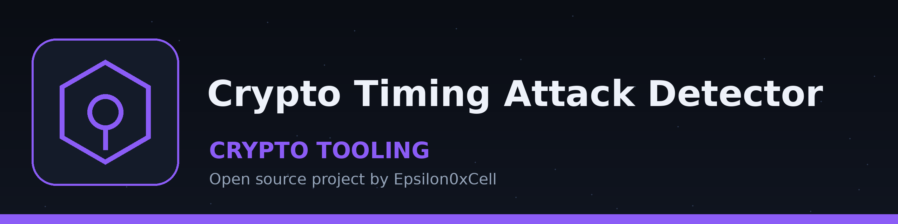
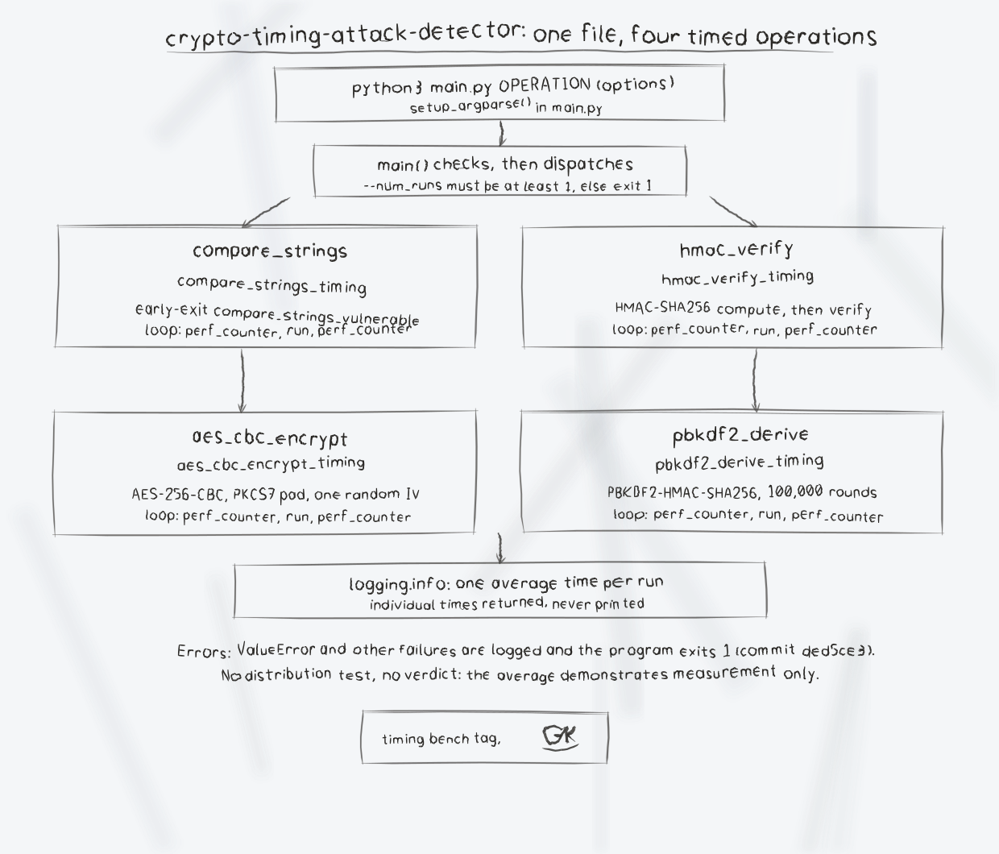

# crypto-timing-attack-detector

Measures the average execution time of four basic cryptographic operations over repeated runs and logs the result, as a simple demonstration of timing measurement. It reports one average time per run of the program. It does not compare timing distributions, run statistical tests, or produce a vulnerability verdict.

## Requirements

- Python 3
- cryptography 41.0.7 or newer (see requirements.txt)

## Install

```bash
git clone https://github.com/ShadowGuard-AI/crypto-timing-attack-detector.git
cd crypto-timing-attack-detector
pip install -r requirements.txt
```

## Usage

```bash
python3 main.py [-h] [--num_runs NUM_RUNS] [--string1 STRING1] [--string2 STRING2] [--message MESSAGE] [--key KEY] [--password PASSWORD] [--salt SALT] OPERATION
```

OPERATION is one of: `compare_strings`, `hmac_verify`, `aes_cbc_encrypt`, `pbkdf2_derive`.

## Operations

- `compare_strings`: Times an intentionally early exit string comparison (it returns on the first mismatched character, and immediately when the lengths differ). Uses `--string1` and `--string2`.
- `hmac_verify`: Computes an HMAC-SHA256 of `--message` with `--key`, then repeatedly computes and verifies it and times those runs.
- `aes_cbc_encrypt`: Times AES-256-CBC encryption of `--message` with PKCS7 padding and a random IV generated once per invocation. The `--key` string is hashed with SHA-256 to derive the 32 byte AES key, so a key string of any length works.
- `pbkdf2_derive`: Times PBKDF2-HMAC-SHA256 key derivation from `--password` and `--salt` with a fixed 100,000 iterations and a 32 byte output. With the default `--num_runs 100` this takes a while.

## Parameters

- `-h`, `--help`: Show help message and exit.
- `--num_runs`: Number of times to run the operation for timing analysis (default: 100). Must be at least 1.
- `--string1`: First string for string comparison (default: `test_string`).
- `--string2`: Second string for string comparison (default: `test_string`).
- `--message`: Message for HMAC or AES operations (default: `This is a test message.`).
- `--key`: Key for HMAC or AES operations (default: `secret_key`). Used directly as the HMAC key, and hashed with SHA-256 to derive the AES key.
- `--password`: Password for the PBKDF2 operation (default: `password`).
- `--salt`: Salt for the PBKDF2 operation (default: `salt`).

## Examples

```bash
python3 main.py compare_strings --num_runs 20
python3 main.py compare_strings --num_runs 20 --string1 abcdef --string2 abcxyz
python3 main.py hmac_verify --num_runs 20
python3 main.py aes_cbc_encrypt --num_runs 5
python3 main.py pbkdf2_derive --num_runs 3
```

Example output (timestamps and times vary):

```text
2026-10-30 13:49:58,853 - INFO - Average time for AES-CBC encryption: 0.008183 seconds
```

## Limitations

- Only the average time is logged. Individual run times are returned by the library functions but are not printed, and no minimum, maximum, or variance is reported.
- Input errors (for example `--num_runs 0`) are logged as errors and the program exits with status 1.
- Timings at this scale are dominated by interpreter and library overhead, so the averages demonstrate measurement only and are not evidence that an operation is or is not exploitable.
- There are no bundled tests.

## License

Copyright (c) ShadowStrikeHQ. No license file is included in this repository.

## Diagrams and maps

I drew the system out in [crypto-timing-attack-detector-Visuals](crypto-timing-attack-detector-Visuals/): an architecture diagram, a sequence diagram of one timed run, a flowchart of a run, and a product map, with the written product map, statistics with citations, and the roadmap in [VISUAL.md](crypto-timing-attack-detector-Visuals/VISUAL.md). Every sheet also ships as a PNG photograph of the paper page beside its SVG.


